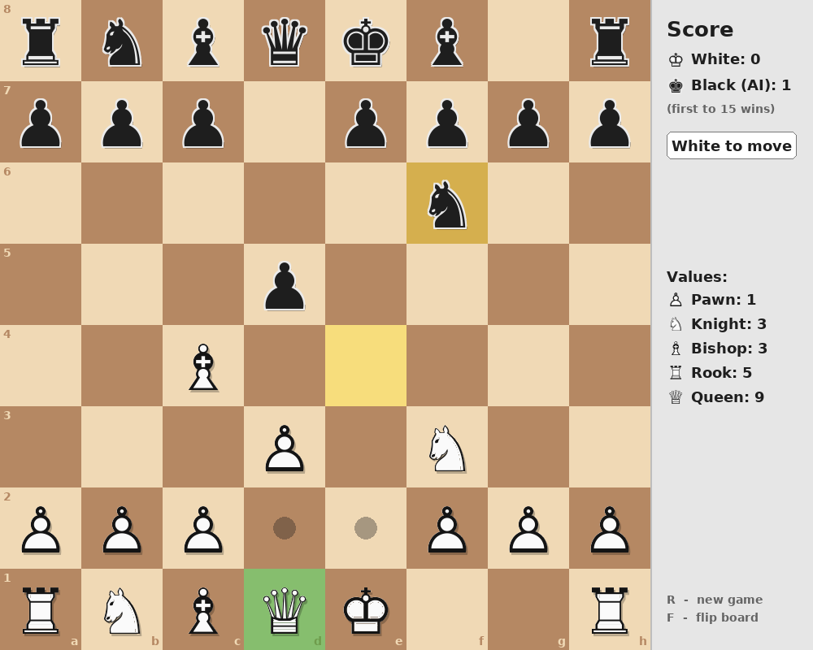

# My Chess Game

A chess game made with Python and [pygame](https://www.pygame.org/). Play against the computer or against a friend on the same computer.



## Features

- **Chess piece symbols** (♔ ♕ ♖ ♗ ♘ ♙ / ♚ ♛ ♜ ♝ ♞ ♟) drawn with the bundled `DejaVuSans-Bold.ttf` font, so they look the same on every computer
- **Computer opponent** that looks several moves ahead (see [How the AI works](#how-the-ai-works))
- **Real check rules**: you can't make a move that leaves your king in check, and the game ends on **checkmate** or **stalemate**
- **Score board**: every capture earns points, and the first player to **15 points** wins
- **Pawn promotion**: choose a Queen, Rook, Bishop or Knight when a pawn reaches the far side
- Highlights for the selected piece, the squares it can move to, the last move played, and a king in check
- Board coordinates (a–h, 1–8), board flipping, and a **New game** key

## Getting started

You need Python 3.8 or newer.

```bash
# (optional) make a virtual environment
python -m venv chessvenv
source chessvenv/bin/activate      # Windows: chessvenv\Scripts\activate

# install pygame
pip install -r requirements.txt

# play!
python main.py
```

### Options

| Command | What it does |
| --- | --- |
| `python main.py` | You play White, the computer plays Black |
| `python main.py --ai white` | The computer plays White (and moves first), you play Black |
| `python main.py --ai none` | Two players on one computer; the board flips after every move |
| `python main.py --think-time 5` | Let the computer think for up to 5 seconds per move (default: 2). More time = stronger play |

## How to play

- **Click** one of your pieces to select it. Dots show the squares it can move to, and a ring shows a piece you can capture.
- **Click** one of those squares to move there.
- The **yellow** squares show the last move played. A **red glow** means a king is in check.
- When a pawn reaches the other side, pick the piece it becomes (click it, or press **Q**, **R**, **B** or **N**).

| Key | Action |
| --- | --- |
| `R` | Start a new game |
| `F` | Flip the board |

## Rules

The pieces move like normal chess. A game ends when:

1. A player is **checkmated** – the other player wins.
2. A player reaches **15 points** from captures – that player wins.
3. A player has no legal move but is not in check (**stalemate**) – it's a draw.

Points for capturing a piece:

| Piece | Points |
| --- | --- |
| ♙ Pawn | 1 |
| ♘ Knight | 3 |
| ♗ Bishop | 3 |
| ♖ Rook | 5 |
| ♕ Queen | 9 |

**Not added yet:** castling, en passant, and draws by repetition or the 50-move rule.

## How the AI works

The computer (`ai.py`) uses **minimax search with alpha-beta pruning**:

- It tries its moves, then your best replies, then its replies to those, and so on. It searches 1 move deep, then 2, then 3, ... until its thinking time runs out (iterative deepening), and plays the best move from the deepest search it finished.
- At the end of the search it keeps following captures (**quiescence search**), so it doesn't stop in the middle of a trade and think it won a piece it's about to lose.
- It scores positions on **material**, the **15-point score race**, and **where pieces stand** (piece-square tables: knights like the centre, pawns like to advance, the king stays safe until the endgame).
- It knows about checkmate, stalemate, and that reaching 15 points wins immediately.
- It thinks in a background thread, so the window keeps responding while it thinks.

## Project files

| File | What's in it |
| --- | --- |
| `main.py` | Starts the game: the game loop, mouse/keyboard input, turns, and win/draw detection |
| `board.py` | Window size, colours, the starting position, the score board, and all the drawing (board, piece symbols, sidebar, game-over screen) |
| `pieces.py` | Chess rules: how each piece moves, check, checkmate and stalemate |
| `ai.py` | The computer opponent |
| `promotion.py` | The "promote pawn to..." pop-up |
| `DejaVuSans-Bold.ttf` | Font used for the piece symbols and text |
| `tests/test_chess.py` | Automatic checks for the rules and the AI |

## Running the tests

```bash
python -m unittest discover tests
```
