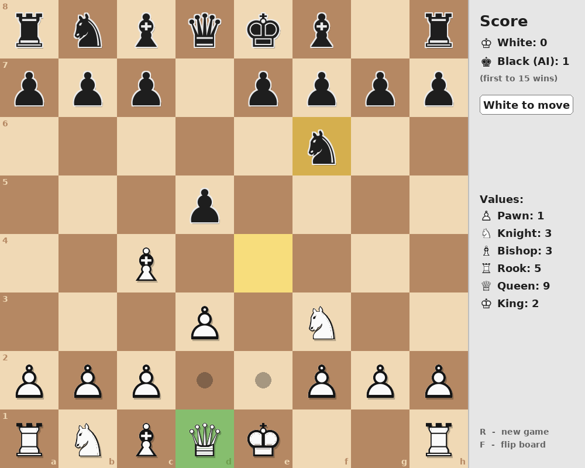

# Points-Race Chess

Chess with a different way to win: there is no check or checkmate, every capture scores points, and the first player to **15 points** wins. Made with Python and [pygame](https://www.pygame.org/). Play against the computer or against a friend on the same computer.

**[Play it in your browser](https://krishpatelkp2423-dot.github.io/projects/chess.html#play)** (no install needed), or read the [project write-up](https://krishpatelkp2423-dot.github.io/projects/chess.html).



## Features

- **Chess piece symbols** (♔ ♕ ♖ ♗ ♘ ♙ / ♚ ♛ ♜ ♝ ♞ ♟) drawn with the bundled `DejaVuSans-Bold.ttf` font, so they look the same on every computer
- **Computer opponent** that looks several moves ahead (see [How the AI works](#how-the-ai-works))
- **Points race**: every capture earns points, and the first player to **15 points** wins. There is no check or checkmate – the King is a normal piece worth 2 points that can be captured
- **Pawn promotion**: choose a Queen, Rook, Bishop, Knight or King when a pawn reaches the far side
- Highlights for the selected piece, the squares it can move to, and the last move played
- Board coordinates (a–h, 1–8), board flipping, and a **New game** key

## Getting started

You need Python 3.8 or newer.

```bash
# (optional) make a virtual environment
python -m venv chessvenv
source chessvenv/bin/activate      # Windows: chessvenv\Scripts\activate

# install pygame
pip install -r requirements.txt

# play!
python main.py
```

### Options

| Command | What it does |
| --- | --- |
| `python main.py` | You play White, the computer plays Black |
| `python main.py --ai white` | The computer plays White (and moves first), you play Black |
| `python main.py --ai none` | Two players on one computer; the board flips after every move |
| `python main.py --think-time 5` | Let the computer think for up to 5 seconds per move (default: 2). More time = stronger play |

## How to play

- **Click** one of your pieces to select it. Dots show the squares it can move to, and a ring shows a piece you can capture.
- **Click** one of those squares to move there.
- The **yellow** squares show the last move played.
- When a pawn reaches the other side, pick the piece it becomes (click it, or press **Q**, **R**, **B**, **N** or **K**).

| Key | Action |
| --- | --- |
| `R` | Start a new game |
| `F` | Flip the board |

## Rules

The pieces move like normal chess, but there is **no check or checkmate**. The King is just another piece: it can be captured and is worth 2 points.

**The only way to win is to be the first player to reach 15 points** from captures.

If a player has no possible moves, their turn is skipped. If neither player can move, the game is a draw.

Points for capturing a piece:

| Piece | Points |
| --- | --- |
| ♙ Pawn | 1 |
| ♘ Knight | 3 |
| ♗ Bishop | 3 |
| ♖ Rook | 5 |
| ♕ Queen | 9 |
| ♔ King | 2 |

**Not added yet:** castling and en passant.

## How the AI works

The computer (`ai.py`) uses **minimax search with alpha-beta pruning**:

- It tries its moves, then your best replies, then its replies to those, and so on. It searches 1 move deep, then 2, then 3, ... until its thinking time runs out (iterative deepening), and plays the best move from the deepest search it finished.
- At the end of the search it keeps following captures (**quiescence search**), so it doesn't stop in the middle of a trade and think it won a piece it's about to lose.
- It scores positions on **material**, the **15-point score race**, and **where pieces stand** (piece-square tables: knights like the centre, pawns like to advance, the king stays safe until the endgame).
- It knows the King is worth 2 points and that reaching 15 points wins immediately, so it will take your King if you leave it unprotected (and guards its own).
- It avoids going back to a position the game has already been in, so it doesn't shuffle the same pieces back and forth forever.
- It thinks in a background thread, so the window keeps responding while it thinks.

### Does looking further ahead help?

`selfplay.py` plays the AI against itself at two search depths and reports the results. Each opening (four random moves) is played twice with the sides swapped, and the searches are limited by depth instead of time, so the same command always gives the same numbers.

```bash
python selfplay.py --a 3 --b 1 --games 40
```

| Match | Games | Result |
| --- | --- | --- |
| Looks 3 moves ahead vs. 1 move ahead | 40 | The deeper search won 39, lost 1 |

Half of those games lasted 44 moves or fewer (counting both sides' moves). Before the AI learned to avoid repeated positions, some of these games never finished: both sides shuffled pieces until the 400-move limit.

## Project files

| File | What's in it |
| --- | --- |
| `main.py` | Starts the game: the game loop, mouse/keyboard input, turns, and checking for a winner |
| `board.py` | Window size, colours, the starting position, the score board, and all the drawing (board, piece symbols, sidebar, game-over screen) |
| `pieces.py` | Chess rules: how each piece moves |
| `ai.py` | The computer opponent |
| `selfplay.py` | Plays the AI against itself and reports the results |
| `promotion.py` | The "promote pawn to..." pop-up |
| `DejaVuSans-Bold.ttf` | Font used for the piece symbols and text |
| `tests/test_chess.py` | Automatic checks for the rules and the AI |

## Running the tests

```bash
python -m unittest discover tests
```
